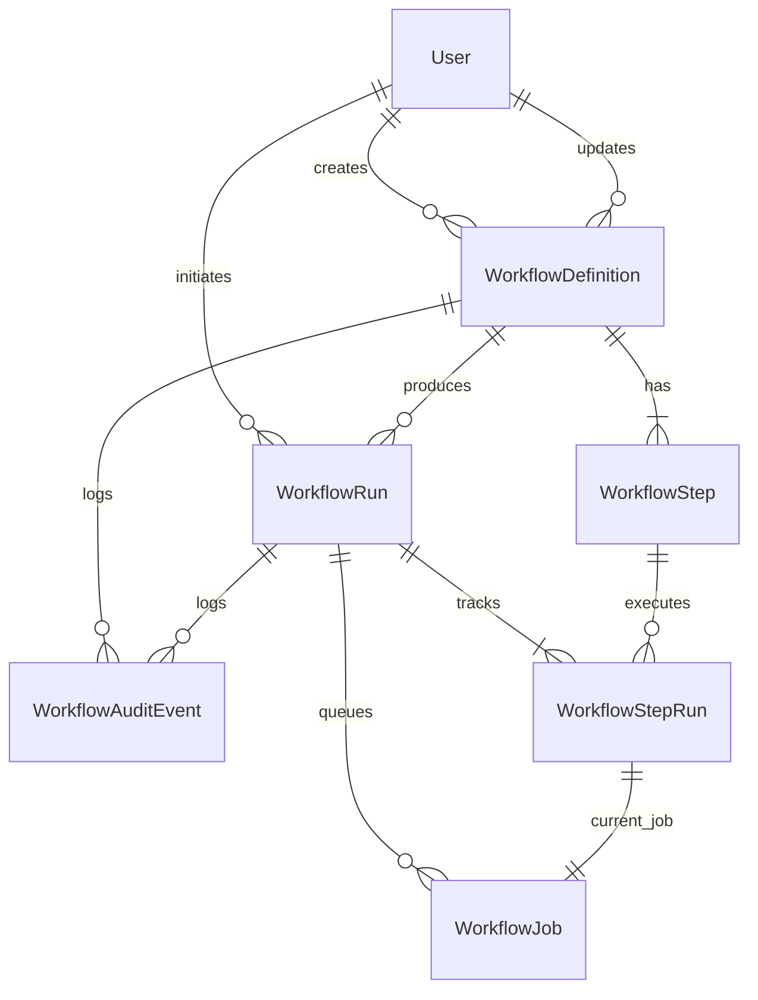

# Domain Model

Entities:
- `User`
  - Schema/model: `prisma/schema.prisma` (`model User`)
  - Primary service: `src/services/auth-service.ts` (`authService.login()`)
- `WorkflowDefinition`
  - Schema/model: `prisma/schema.prisma` (`model WorkflowDefinition`)
  - Primary service: `src/services/workflow-definition-service.ts` (`createWorkflow()`, `updateWorkflow()`, `transitionWorkflowStatus()`)
- `WorkflowStep`
  - Schema/model: `prisma/schema.prisma` (`model WorkflowStep`)
  - Primary service: `src/services/workflow-execution-service.ts` (`drainOnce()` reads step config and condition)
- `WorkflowRun`
  - Schema/model: `prisma/schema.prisma` (`model WorkflowRun`)
  - Primary service: `src/services/workflow-dispatch-service.ts` (`triggerWorkflowManually()`, `ingestEvent()`, `dispatchScheduledRuns()`)
- `WorkflowStepRun`
  - Schema/model: `prisma/schema.prisma` (`model WorkflowStepRun`)
  - Primary service: `src/services/workflow-execution-service.ts` (`drainOnce()` transitions step state)
- `WorkflowJob`
  - Schema/model: `prisma/schema.prisma` (`model WorkflowJob`)
  - Primary service: `src/services/workflow-execution-service.ts` (`drainOnce()`)
- `WorkflowAuditEvent`
  - Schema/model: `prisma/schema.prisma` (`model WorkflowAuditEvent`)
  - Primary service: `src/repositories/workflow-run-repository.ts` (`createAuditEvent()`), called from definition, dispatch, and execution services

Notes:
- Triggers are modeled on `WorkflowDefinition` itself through `triggerType`, `eventName`, `cronExpression`, and `nextScheduledAt` in `prisma/schema.prisma`.
- Conditional logic is stored in `WorkflowStep.condition` and evaluated in `src/lib/workflow/conditions.ts`.
- Safe action config lives in `WorkflowStep.config` and is validated by `src/lib/validation/workflow-schemas.ts` before it is executed by `src/services/workflow-execution-service.ts`.
