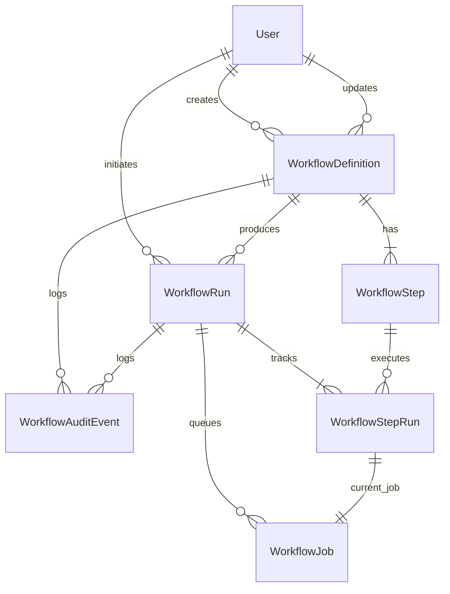

# Domain Model



Entities:
- `User`
  - Schema/model: `prisma/schema.prisma` (`model User`)
  - Primary service: `src/services/auth-service.ts` (`authService.login()`)
- `WorkflowDefinition`
  - Schema/model: `prisma/schema.prisma` (`model WorkflowDefinition`)
  - Primary service: `src/services/workflow-definition-service.ts` (`createWorkflow()`, `updateWorkflow()`, `transitionWorkflowStatus()`)
- `WorkflowStep`
  - Schema/model: `prisma/schema.prisma` (`model WorkflowStep`)
  - Primary service: `src/services/workflow-execution-service.ts` (`drainOnce()` reads step config and condition)
- `WorkflowRun`
  - Schema/model: `prisma/schema.prisma` (`model WorkflowRun`)
  - Primary service: `src/services/workflow-dispatch-service.ts` (`triggerWorkflowManually()`, `ingestEvent()`, `dispatchScheduledRuns()`)
- `WorkflowStepRun`
  - Schema/model: `prisma/schema.prisma` (`model WorkflowStepRun`)
  - Primary service: `src/services/workflow-execution-service.ts` (`drainOnce()` transitions step state)
- `WorkflowJob`
  - Schema/model: `prisma/schema.prisma` (`model WorkflowJob`)
  - Primary service: `src/services/workflow-execution-service.ts` (`drainOnce()`)
- `WorkflowAuditEvent`
  - Schema/model: `prisma/schema.prisma` (`model WorkflowAuditEvent`)
  - Primary service: `src/repositories/workflow-run-repository.ts` (`createAuditEvent()`), called from definition, dispatch, and execution services

Notes:
- Triggers are modeled on `WorkflowDefinition` itself through `triggerType`, `eventName`, `cronExpression`, and `nextScheduledAt` in `prisma/schema.prisma`.
- Conditional logic is stored in `WorkflowStep.condition` and evaluated in `src/lib/workflow/conditions.ts`.
- Safe action config lives in `WorkflowStep.config` and is validated by `src/lib/validation/workflow-schemas.ts` before it is executed by `src/services/workflow-execution-service.ts`. That validation runs only on API writes. Rows written another way skip it, and the seed is the example: its step configs at `prisma/seed.ts:92-95` and `:107-117` have no `type` discriminator, so `executeAction()` cannot dispatch them (see `docs/learning/flow-traces.md`, "Seeded workflow fails").
- Diagram correction: `WorkflowStepRun` to `WorkflowJob` is really zero-or-one. The relation field is a list (`jobs WorkflowJob[]`, `prisma/schema.prisma:161`), but `WorkflowJob.stepRunId` is `@unique` (line 171). A step run has no job until the previous step finishes or is skipped, and exactly one after that. Retries reuse that same row.

## Status enums and who writes them

| Enum (`prisma/schema.prisma`) | Values | Written by |
| --- | --- | --- |
| `WorkflowStatus` (24-29) | DRAFT, ACTIVE, PAUSED, ARCHIVED | `workflowRepository.updateStatus()` (`src/repositories/workflow-repository.ts:159-168`), called from `transitionWorkflowStatus()` and from `dispatchScheduledRuns()`. The dispatch call rewrites `ACTIVE` while advancing `nextScheduledAt` (`src/services/workflow-dispatch-service.ts:98`) |
| `WorkflowRunStatus` (36-42) | QUEUED, RUNNING, SUCCEEDED, FAILED, CANCELLED | QUEUED on create (`workflow-run-repository.ts:46`), RUNNING by `markRunRunning`/`markStepSucceeded`/`markStepRetrying`, SUCCEEDED when no next step exists (lines 180-186, 228-234), FAILED by `markStepFailed` (285-291). **CANCELLED is never written.** No cancel path exists |
| `WorkflowStepStatus` (44-51) | PENDING, SKIPPED, RUNNING, SUCCEEDED, FAILED, RETRYING | PENDING on create (line 57), then the `mark*` functions in `workflow-run-repository.ts` |
| `WorkflowJobStatus` (59-64) | AVAILABLE, LEASED, SUCCEEDED, DEAD | AVAILABLE by default and on retry (line 254), LEASED by the raw lease SQL (`workflow-job-repository.ts:30`), SUCCEEDED/DEAD by `markSucceeded`/`markDead` |

Workflow lifecycle (`src/lib/workflow/status-machine.ts:15-20`, all 16 pairs enumerated by `node --test`; see `docs/learning/testing-rationale.md`):

```
DRAFT --> ACTIVE <--> PAUSED
  |          |           |
  +----------+-----------+--> ARCHIVED (terminal)
```

Same-status "transitions" are always allowed (line 23-25). For example, re-posting `ACTIVE` on an active workflow re-runs the activation checks and recomputes `nextScheduledAt`.

## Delete and foreign-key behavior

| Relation | `onDelete` | Line | Practical effect |
| --- | --- | --- | --- |
| `WorkflowDefinition.createdBy` / `updatedBy` to `User` | Restrict | 96-97 | Users who own or touched workflows cannot be deleted |
| `WorkflowStep.workflow` | Cascade | 117 | Deleting a definition deletes its steps |
| `WorkflowRun.workflow` | Restrict | 135 | A definition with runs cannot be deleted. There is no delete route anyway |
| `WorkflowRun.initiatedBy` | SetNull | 136 | Run history survives user deletion |
| `WorkflowStepRun.step` | **Restrict** | 160 | **A step that any run has used cannot be deleted** |
| `WorkflowStepRun.run`, `WorkflowJob.run`, `WorkflowJob.stepRun` | Cascade | 159, 180, 181 | Run trees delete together |
| `WorkflowAuditEvent.workflow` / `run` | Cascade | 197-198 | Deleting a run deletes its audit trail |

**Verified finding: editing a workflow that has run breaks.** `workflowRepository.updateWorkflow()` replaces steps wholesale. It calls `tx.workflowStep.deleteMany({ where: { workflowId } })` (`src/repositories/workflow-repository.ts:136`) and recreates them (line 148-150). Once any run exists, its `WorkflowStepRun` rows point at the old steps through a `Restrict` FK (`schema.prisma:160`), so the delete fails inside the transaction. Prisma raises a foreign-key error, which is not an `AppError`, and `executeRoute()` returns a 500. Runs can only exist for workflows that were ACTIVE at some point, so in practice **no activated-and-used workflow is editable**. The same FK breaks re-running `npm run db:seed` after the seeded workflow has run, because `prisma/seed.ts:83` deletes its steps the same way.
- Fix options: version steps (insert new rows, mark old ones retired) instead of deleting, or diff the step list and update rows in place by `id`. The schema already accepts an optional `id` per step (`workflow-schemas.ts:67`), but `mapWorkflowSteps()` ignores it (`workflow-repository.ts:30-40`).

## Columns that exist but are not used as their name suggests

| Column | Reality |
| --- | --- |
| `WorkflowStep.timeoutSeconds` | Validated and stored, never read by the worker. `fetch()` has no abort signal (`workflow-execution-service.ts:63-67`) |
| `WorkflowJob.leasedUntil` | Written on lease, never compared to `NOW()`, so expired leases are not reclaimed |
| `WorkflowJob.leaseToken` | Written on lease, never checked on `markSucceeded()`/`markDead()` (both update by `id` only, `workflow-job-repository.ts:69-90`) |
| `WorkflowRun.startedAt` | Overwritten with `new Date()` by `markRunRunning()` (line 143), `markStepSucceeded()` (line 215), and `markStepRetrying()` (line 267). On a multi-step run it holds the time the latest step started, not when the run started |
| `WorkflowStepRun.inputSnapshot` | Set to the trigger payload (`workflow-execution-service.ts:136`), not to the resolved action config |
| `WorkflowDefinition.slug` | `slugify(name + "-" + Date.now())` (`workflow-repository.ts:115`). It is unique only by timestamp and never used for lookup outside the seed |

## Exercises

1. **Goal:** Reproduce the edit-after-run failure in a local DB. Trigger the seeded workflow once, then PATCH it. **Check:** the response is 500, and the Postgres log shows a foreign-key violation on `WorkflowStepRun_stepId_fkey`.
2. **Goal:** Make `startedAt` mean "run start". **Check:** after a three-step run, `startedAt` equals the first step's `startedAt`, not the last one's.
3. **Goal:** Add a cancel path that writes `CANCELLED` and marks the pending job `DEAD`. **Check:** a cancelled run's remaining step runs stay `PENDING`, and no worker picks up its job.
